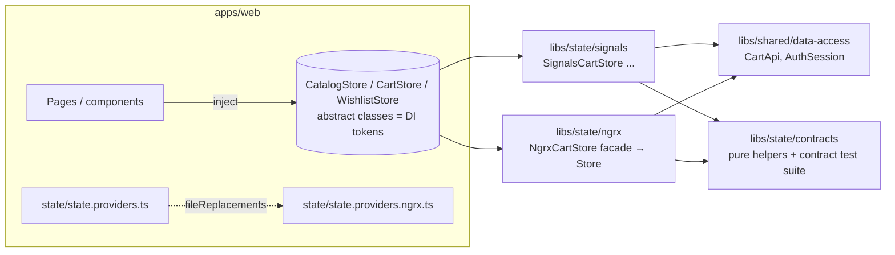

# 04 — Signals vs RxJS vs NgRx

The same three features — **catalog, cart, wishlist** — are implemented twice: once with Angular Signals services
(`libs/state/signals`) and once with classic NgRx Store/Actions/Reducers/Selectors/Effects (`libs/state/ngrx`).
Pages cannot tell which one is running. This document compares them using that code.

## 1. Problem

Shared client state (filters + results, a cart that follows the signed-in user, an optimistic wishlist) has to be
consistent across pages, survive async races, reset on sign-out and stay testable. The question is which tool owns it.

## 2. Context and constraints

- Angular 21, zoneless, `OnPush` everywhere: templates must read **signals** to update.
- Requirement: both variants runnable and tested, never both active in one app instance, UI shared.
- No tokens or personal data in either store (security requirement).

## 3. The three tools — what each is for

| Tool | Model | Best at | Weak at |
| --- | --- | --- | --- |
| **Signals** | synchronous reactive *values* with automatic dependency tracking | current state + derived values for templates | time: debouncing, cancellation, retries, merging event streams |
| **RxJS** | *streams of events over time* | async orchestration: `switchMap` cancellation, `timer`, retry, combining sources | holding "the current value" for templates (needs `async` pipe / `toSignal`) |
| **NgRx** | Redux: state changes only via **actions** → pure **reducers**; async in **effects**; reads via **selectors** | traceability (every change is a named event), DevTools time travel, strict conventions for big teams | boilerplate, indirection for small features |

They are not mutually exclusive: **both** variants use RxJS for HTTP orchestration and **both** expose Signals to
components (NgRx via `store.selectSignal`). The real comparison is *Signals services vs a global Redux store*.

## 4. Architecture



Variant selection is a **build-time** decision (`apps/web/project.json`):

```json
"production-ngrx": {
  "outputPath": "dist/apps/web-ngrx",
  "fileReplacements": [{ "replace": "apps/web/src/app/state/state.providers.ts",
                         "with": "apps/web/src/app/state/state.providers.ngrx.ts" }]
}
```

Because only one providers file is compiled, the other implementation is not even in the bundle (verified: the
Signals build's JS contains no `@ngrx/store` code). A lint rule (`apps/web/eslint.config.mjs`) forbids importing
either implementation anywhere else in the app.

## 5. The contract both implement

```ts
// libs/state/contracts/src/lib/state-contracts.ts
export abstract class CartStore {
  abstract readonly lines: Signal<readonly CartLine[]>;
  abstract readonly itemCount: Signal<number>;
  abstract readonly estimatedSubtotal: Signal<number>;   // client estimate (display only)
  abstract readonly quote: Signal<CartQuote | null>;      // server-calculated totals
  abstract readonly quoteStatus: Signal<RequestStatus>;
  abstract readonly canCheckout: Signal<boolean>;
  abstract add(product: CartProduct, quantity?: number): void;
  abstract updateQuantity(productId: number, quantity: number): void;
  abstract remove(productId: number): void;
  abstract clear(): void;
  abstract refreshQuote(): void;
}
```

Reads are `Signal`s, commands are methods. Business rules both variants must share (`addCartLine`,
`clampQuantity`, `estimateSubtotal` in integer cents, `applyFilterPatch`, `cartForIdentityChange`) are **pure
functions in the contracts library**, so the variants differ only in *state mechanics*, not in rules.

## 6. Side by side: the cart

### State ownership and derived state

```ts
// Signals — libs/state/signals/src/lib/signals-cart.store.ts
private readonly state = signal<CartState>({ lines: [], quote: null, quoteStatus: 'idle', quoteError: null });
readonly lines = computed(() => this.state().lines);
readonly itemCount = computed(() => cartItemCount(this.lines()));
readonly canCheckout = computed(() => !this.isEmpty() && this.quoteStatus() === 'success' && this.quote()?.canCheckout === true);
```

```ts
// NgRx — libs/state/ngrx/src/lib/cart/cart.feature.ts
export const cartAdapter = createEntityAdapter<CartLine>({ selectId: (line) => line.productId });
export const cartFeature = createFeature({
  name: 'cart',
  reducer: createReducer(initialCartState,
    on(cartActions.quantityUpdated, (state, { productId, quantity }) =>
      linesChanged(cartAdapter.updateOne({ id: productId, changes: { quantity: clampQuantity(quantity) } }, state))),
    /* ... */),
  extraSelectors: ({ selectCartState, selectQuote, selectQuoteStatus }) => {
    const selectLines = createSelector(selectCartState, cartAdapter.getSelectors().selectAll);
    return { selectLines, selectItemCount: createSelector(selectLines, cartItemCount), /* ... */ };
  },
});
```

### `computed` vs selectors

| | `computed` | `createSelector` |
| --- | --- | --- |
| Memoization | recomputes when a signal it **read** changes (dynamic dependency tracking) | recomputes when an **input selector's** result changes (`===`) |
| Laziness | lazy, cached until a dependency changes | memoized per selector instance |
| Composition | call other computeds | pass selectors as inputs |
| Consumption | read directly in templates | `store.selectSignal(selector)` → a signal, or `store.select` → Observable |

Both give "derive, don't store". In this repo `itemCount`, `estimatedSubtotal` and `canCheckout` are derived in
both variants; none of them is ever written.

### Commands

```ts
// Signals: a method updates state immutably
updateQuantity(productId: number, quantity: number): void {
  this.setLines(this.lines().map((l) => (l.productId === productId ? { ...l, quantity: clampQuantity(quantity) } : l)));
}
// NgRx: the facade dispatches a typed action; the reducer computes the next state
updateQuantity(productId: number, quantity: number): void {
  this.store.dispatch(cartActions.quantityUpdated({ productId, quantity }));
}
```

### Async workflow: the server quote (where effects belong)

Both variants use **the same RxJS shape**; only the trigger differs (a `Subject` vs the `Actions` stream):

```ts
// NgRx — cart.effects.ts
export const quoteCart = createEffect(
  (actions$ = inject(Actions), store = inject(Store), api = inject(CartApi), debounce = inject(CART_QUOTE_DEBOUNCE_MS)) =>
    actions$.pipe(
      ofType(...lineChanges),
      concatLatestFrom(() => store.select(cartFeature.selectLines)),
      switchMap(([, lines]) =>
        lines.length === 0
          ? EMPTY
          : timer(debounce).pipe(
              switchMap(() => api.quote(lines.map(({ productId, quantity }) => ({ productId, quantity })))),
              map((quote) => cartApiActions.quoteLoaded({ quote })),
              catchError((error: unknown) => of(cartApiActions.quoteFailed({ error: toApiError(error) }))))),
    ),
  { functional: true },
);
```

```ts
// Signals — signals-cart.store.ts (constructor)
this.quoteRequests.pipe(
  switchMap((lines) => lines.length === 0 ? EMPTY : timer(debounce).pipe(
    switchMap(() => this.api.quote(lines.map(({ productId, quantity }) => ({ productId, quantity })))),
    map((quote) => ({ quote, error: null })),
    catchError((error: unknown) => of({ quote: null, error: toApiError(error) })))),
  takeUntilDestroyed(),
).subscribe(({ quote, error }) => this.state.update((s) => ({ ...s, quote, quoteStatus: error ? 'error' : 'success', quoteError: error })));
```

**Where effects belong:** in NgRx, anything impure (HTTP, storage, timers, reading the session) lives in effects —
reducers stay pure (enforced in development by `strictStateImmutability`/`strictActionImmutability` runtime checks in
`provide-ngrx-state.ts`). In the Signals variant the same work is an RxJS pipeline inside the service. Angular's
`effect()` is used **only** for a genuine side effect — mirroring the cart to `localStorage`:

```ts
effect(() => this.persistence.write(this.userId, this.lines()));   // not used to derive state
```

## 7. Request cancellation and stale responses

| Scenario | Operator | Why |
| --- | --- | --- |
| Catalog filters change while a request is in flight | `switchMap` | latest wins; the old HTTP request is unsubscribed (aborted) so its response can never overwrite newer results |
| Cart changes during the quote debounce or while a quote is loading | `switchMap(() => timer(ms).pipe(switchMap(quote)))` | a plain `debounceTime` would leave an old request running; this cancels both the timer and the request |
| Cart emptied while a quote is in flight | `EMPTY` in the same `switchMap` | the in-flight quote is cancelled and nothing is applied (this was a real bug, found and fixed) |
| Wishlist add/remove for different products | `mergeMap` | independent writes must all complete |
| Wishlist load when the user signs out | `takeUntil(reset)` (NgRx), `switchMap` on identity (Signals) | the previous user's response must not appear for the next user |

Tested once for both variants in `state-contract-suite.ts`: "resets to page 1 on a filter change and never applies
the stale response", "never applies a quote for an older cart: emptying the cart cancels it", "never lets a load
started before sign-out repopulate the next session", "rolls back only the failed removal when several are in flight".

## 8. Component-local vs shared state

| Kind | Where | Example |
| --- | --- | --- |
| Ephemeral UI state | `signal()` in the component | mobile menu open, `priceRangeInvalid` in `catalog-filters-panel.ts` |
| Value derived from an input | `linkedSignal` | product page `quantity` resets to 1 when the product changes |
| Page data used by one page | `toSignal(toObservable(input).pipe(switchMap(id => loadable(api.get(id)))))` | product detail, order detail, admin pages |
| URL-shareable state | router query params (source of truth) → store | catalog filters (`catalog-query-params.ts`) |
| Cross-page / per-user state | `libs/state` (this document) | catalog results, cart, wishlist |
| Session/identity | `AuthSession` service (not a store) | access token in a private field; `user` signal |

Rule of thumb used here: **put state in the global layer only when two unrelated parts of the UI need it, or it must
outlive navigation.** Product detail data is deliberately *not* in a store.

## 9. Logout and user-specific reset

Both variants subscribe to `AuthSession.userIdChanges$` (a `distinctUntilChanged` stream of the signed-in id):

- cart: `cartForIdentityChange` merges the guest cart into the user's cart on sign-in and deletes the previous user's
  saved cart on sign-out (shared-device privacy, KI-11);
- wishlist: reset immediately, then load for the new user; in-flight loads for the old user are cancelled.

In NgRx this is an effect that starts from a non-action observable (`restoreCartOnIdentityChange`); in the Signals
variant it is a subscription in the store constructor, and the stores are created eagerly
(`provideEnvironmentInitializer` in `provide-signals-state.ts`) so they follow login before any page asks for them.

## 10. Testing strategies

- **One behavioural contract suite** (`libs/state/contracts/src/testing/state-contract-suite.ts`) runs against both
  implementations (`signals-state.contract.spec.ts`, `ngrx-state.contract.spec.ts`) through the abstract contract
  only, with `HttpTestingController`. This is what makes "both variants behave the same" a tested claim.
- **NgRx-only unit tests** for pure reducers and memoized selectors (`cart.feature.spec.ts`) — cheap, no TestBed.
- Signals services need no extra tests beyond the contract: their internals are private by design.
- Current result (2026-10-18): state-signals 15 tests, state-ngrx 21 tests, state-contracts 19 tests — all passing.

## 11. Debugging and observability

| | Signals | NgRx |
| --- | --- | --- |
| Inspect state | Angular DevTools (signal graph), breakpoints in store methods | Redux DevTools: every action, state diff, time travel (`provideStoreDevtools`, `logOnly` in production) |
| "Who changed this?" | find callers of the store method (few, private `state`) | the action log answers it directly |
| Runtime safety | immutability by convention (`readonly` types) | runtime checks fail fast on mutation/non-serializable state in dev |

## 12. Boilerplate and complexity (this repository)

Counted from the code, not estimated: the cart needs **one file** in the Signals variant
(`signals-cart.store.ts`) and **four** in NgRx (`cart.actions.ts`, `cart.feature.ts`, `cart.effects.ts`,
`ngrx-cart.store.ts`), plus registration in `provide-ngrx-state.ts`. NgRx's extra files buy named events, pure
reducers testable without Angular, and DevTools.

## 13. Performance

Measured production builds (2026-10-18, `npx nx run web:build:production[-ngrx]`):

| Variant | Initial bundle (raw) | Initial (estimated transfer) | All JS |
| --- | --- | --- | --- |
| Signals | 396.05 kB | 105.77 kB | 491,824 B |
| NgRx | 440.09 kB | 118.46 kB | 535,937 B |

≈ 44 kB raw / ≈ 13 kB compressed more for NgRx (Store, Effects, Entity, DevTools). Runtime differences are not
measurable at this app's scale and were not benchmarked. Both variants render through signals, so change detection
is the same in a zoneless app.

## 14. Common mistakes (several were made and fixed here)

- Using `effect()` to copy one signal into another — use `computed`/`linkedSignal`.
- `debounceTime` + `switchMap` and assuming in-flight requests are cancelled during the debounce window.
- Snapshot-based optimistic rollback that undoes *other* successful changes — roll back only the failed item.
- Storing tokens or user PII in a store (both stores here hold none; the token is a private field in `AuthSession`).
- Side effects in reducers; calling HTTP from a component and then dispatching "success" manually.
- Putting everything in the global store (page-local data is component state here).
- Forgetting to reset per-user state on sign-out, or letting an old user's late response land after sign-out.

## 15. When each approach is appropriate

- **Signals services** — default for most Angular apps: small/medium shared state, few developers, need for low ceremony.
- **RxJS** — whenever *time* is involved: cancellation, debounce, polling, websockets, combining event sources.
  Keep it at the edges and convert to signals for templates.
- **NgRx Store** — large apps with many developers, many features reacting to the same events, a need for an audit
  trail of state changes, DevTools-driven debugging, or an existing Redux culture. (NgRx SignalStore is a middle
  ground not used here; see 22.)

## 16. How to migrate between approaches

Because pages depend only on the contracts, migration is per feature:
1. Keep the abstract contract stable; 2. implement the other variant behind it; 3. run the contract suite against
the new implementation; 4. switch the provider for that feature; 5. delete the old implementation. In an app without
contracts, the first step is to introduce such a facade around the existing store.

## 17. Interview questions and strong answers

**Q: Signals or NgRx for a new app?** — "Signals services by default; they give derived state and fine-grained
updates with almost no ceremony. I reach for NgRx when the team and the number of features make the action log,
strict unidirectional flow and DevTools worth the boilerplate. In this project both sit behind the same contract and
pass the same tests, and NgRx costs ~13 kB gzipped and four files instead of one for the cart."

**Q: Where does async logic go?** — "In NgRx, in effects; reducers stay pure. With Signals, in RxJS pipelines inside the
service, converted to signals at the boundary. `effect()` is only for real side effects like persisting to storage."

**Q: How do you avoid stale responses?** — "`switchMap` so a new request unsubscribes from the previous one. For a
debounced call I use `switchMap(() => timer(ms).pipe(switchMap(call)))` because `debounceTime` doesn't cancel an
in-flight request — we had exactly that bug when clearing the cart."

**Q: `computed` vs selectors?** — "Both memoize derived state. `computed` tracks whatever signals it reads; selectors
recompute when input selectors change by reference. `store.selectSignal` bridges them, which is how our NgRx facade
exposes the same `Signal` API as the Signals variant."

**Q: How do you prove two implementations behave the same?** — "One contract test suite written against the abstract
API, executed for each implementation."

## 18. Evidence and confidence

*Verified:* both variants compile and build; contract suite + NgRx reducer tests pass; bundle sizes above; Signals
bundle has no NgRx code; both variants against the real backend in a browser — Playwright projects `signals` and
`ngrx` 23/23 each, also through nginx with production builds (spec 7.4 satisfied). Confidence: high.
