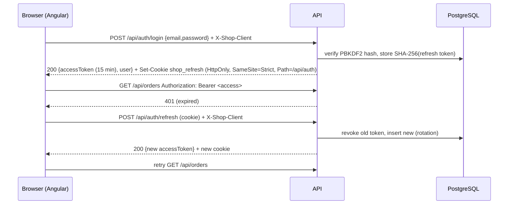

# 11 — Authentication and authorization

## 1. Problem

Customers and admins must sign in; sessions must survive a page reload; stolen tokens must be hard to obtain and
short-lived; admin operations must be impossible for customers regardless of what the browser does.

## 2. Context and constraints

- SPA and API on the **same origin** (dev proxy / nginx).
- Requirement: no tokens, passwords or credentials in NgRx/Signals state or in storage.
- No external identity provider (local accounts, no paid services).

## 3. Options considered

1. JWT in `localStorage` + `Authorization` header.
2. Cookie session (server-side session store / ASP.NET Core cookie auth).
3. **Short-lived JWT access token in memory + long-lived refresh token in an HttpOnly cookie, rotated.**
4. External OIDC provider (Entra ID, Keycloak, Auth0) with code + PKCE / BFF.

## 4. Chosen approach



- **Access token:** JWT (HS256), 15 minutes, claims `sub`, `email`, `name`, `role`; held in a private field of
  `AuthSession` — not a signal, not a store, not storage.
- **Refresh token:** random 256-bit value, stored server-side only as a SHA-256 hash, 7 days, rotated on every use.
  **Reuse detection:** presenting an already revoked token revokes *all* of the user's sessions (token theft signal).
- **CSRF:** cookie-authenticated endpoints (`refresh`, `logout`) require the custom header `X-Shop-Client`; a
  cross-site form cannot set custom headers, and `SameSite=Strict` already withholds the cookie cross-site.
- **Authorization:** role claim → policy `AdminPolicy` on `AdminController`; owner filtering inside queries
  (`WHERE user_id = @current`) so another user's order is a 404.
- **UI guards** (`authGuard`, `adminGuard`, `guestOnlyGuard`) are UX only; the API is the enforcement point.

## 5. Why

- XSS cannot read an HttpOnly cookie, and an in-memory token disappears on reload; the refresh endpoint restores it.
  `localStorage` tokens survive and are trivially exfiltrated by any injected script.
- Stateless access tokens keep API calls cheap (no session lookup); the stateful refresh token gives revocation.
- Same origin means `SameSite=Strict` works and no CORS credentials configuration is needed.

## 6. Trade-offs

- An access token cannot be revoked before expiry (≤ 15 min) — KI-14.
- One refresh per page load (skipped for first-time visitors via the non-sensitive `shop.session` marker).
- Concurrency: several requests can get 401 at once; they must share **one** refresh, because rotation invalidates
  the old cookie. Solved with a shared in-flight observable:

```ts
// libs/shared/data-access/src/lib/auth/auth-session.ts
refresh(): Observable<string | null> {
  this.refreshInFlight ??= this.http.post<AuthResponse>(`${this.base}/refresh`, null).pipe(
    map((response) => { this.apply(response); return response.accessToken; }),
    catchError(() => { this.clear(); return of(null); }),
    finalize(() => (this.refreshInFlight = null)),
    shareReplay({ bufferSize: 1, refCount: false }),
  );
  return this.refreshInFlight;
}
```

## 7. Simpler alternatives

ASP.NET Core cookie authentication (no JWT at all) is simpler and equally secure for a same-origin SPA — a strong
option. JWT was chosen to demonstrate bearer-token APIs that non-browser clients (mobile, other services) can call.

## 8. Rejected alternatives

- **JWT in `localStorage`** — XSS exfiltration, no revocation.
- **External IdP** — the right production answer for SSO/MFA, but requires accounts/config outside the repo (22).

## 9. Implementation references

API: `Features/Auth/AuthController.cs` (cookie options, CSRF check), `AuthService.cs` (hashing, rotation, reuse
detection), `Infrastructure/Auth/TokenService.cs`, `AuthOptions.cs` (validated at startup), `RateLimitPolicies.cs`,
`Program.cs` (JWT validation parameters, `MapInboundClaims = false`).
Web: `libs/shared/data-access/src/lib/auth/{auth-session.ts, auth.interceptor.ts, guards.ts}`,
`apps/web/src/app/features/account/validators.ts` (`safeReturnUrl`).

## 10. Code — the interceptor

```ts
// auth.interceptor.ts (excerpt)
if (usesCookie) {
  return next(request.clone({ setHeaders: { [CSRF_HEADER]: 'web' }, withCredentials: true }));
}
const token = session.getAccessToken();
return next(withBearer(request, token)).pipe(
  catchError((error: unknown) => {
    const expired = error instanceof HttpErrorResponse && error.status === 401 && token !== null;
    if (!expired) return throwError(() => error);
    return session.refresh().pipe(switchMap((t) => (t ? next(withBearer(request, t)) : throwError(() => error))));
  }),
);
```

## 11. Failure scenarios

| Scenario | Behaviour |
| --- | --- |
| Wrong password / unknown email | identical `401 invalid_credentials` (no enumeration); rate-limited |
| Refresh cookie stolen and used after the user refreshed | reuse detected → all sessions revoked |
| Refresh fails | local session cleared; per-user state (cart, wishlist) reset |
| Tampered JWT | signature validation fails → 401 (`Tampered_token_is_rejected`) |
| Missing signing key in production | startup fails (`OptionsValidationException`) — verified by running the API with `ASPNETCORE_ENVIRONMENT=Production` |

## 12. Testing implications

Interceptor unit tests (`auth.interceptor.spec.ts`): bearer only on API calls, CSRF only on cookie endpoints, one
shared refresh for concurrent 401s, sign-out on refresh failure. Session tests: token never in storage. Integration
tests (`AuthApiTests.cs`): cookie flags, rotation + reuse, logout revocation, 403 for customers on admin endpoints.
E2E journey 13 covers the UI and a direct API call.

## 13. Performance and security

Passwords: ASP.NET Core Identity `PasswordHasher` (PBKDF2, salted, versioned — rehash on algorithm upgrade happens at
login, `PasswordVerificationResult.SuccessRehashNeeded`). Password policy: ≥ 8 chars with letters and digits
(`AuthService.EnsureValid`, mirrored by the `passwordStrength` form validator). Rate limits: auth and checkout per IP/user (KI-13).

## 14. When a different approach is better

Multiple apps/SSO/MFA → OIDC with a BFF (backend-for-frontend) that keeps tokens server-side entirely. Pure
same-origin web app with no other clients → plain cookie auth.

## 15. Interview explanation

"The access token is short-lived and lives only in memory; the refresh token is an HttpOnly, SameSite=Strict cookie
scoped to `/api/auth`, stored hashed, rotated on every use, and reuse revokes every session. The interceptor shares a
single refresh between concurrent 401s because rotation makes a second parallel refresh fail. Guards in Angular are
only UX — the API enforces roles and ownership."

## 16. Evidence and confidence

*Verified:* data-access unit tests (incl. interceptor and session), startup validation of the signing key.
Auth integration tests (`AuthApiTests`) pass; E2E covers sign-in, session restore after reload, guest → login → back,
and journey 13 (access control), in both variants and through nginx. Confidence: high.
